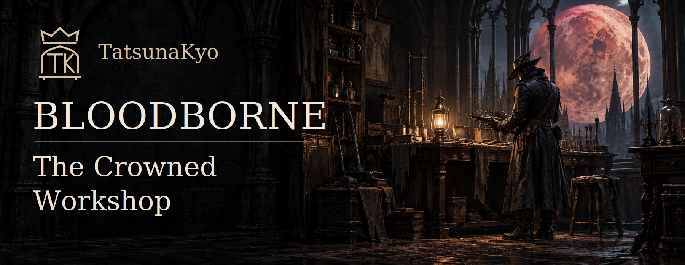

# Bloodborne: The Crowned Workshop

My revision of [Supermedo's Windows port](https://github.com/Supermedo/bloodborne_pc), built on bbport and the shadPS4 renderer. The goal is to make the game more comfortable to play on a modern Windows PC: better window controls, more graphics choices, features and cheats, a configurable overlay and settings you can change during play. This project would NOT be possible without the aforementioned work and people involved.

I call this fork **The Crowned Workshop** because it has become my own place to work on the port. The workshop, lantern and crowned TK emblem are part of that identity; the credit for the original game and the port stays with the people who made them.

**Current revision: v1.6, revision 13.** [Windows releases](https://github.com/TatsunaKyo/bloodborne_pc/releases) · [Revision 13 notes](docs/releases/windows-v1.6-tatsunakyo.13.md) · [Development roadmap](docs/tatsunakyo-next.md)

Always remember that NO game files are included — you NEED your own decrypted **Bloodborne CUSA03173, version 1.09** dump. The game folder must contain `eboot.bin` and its original data. Most game patches and the added cheats depend on 1.09 and will NOT work on any other version of the game.

## How to use it

1. Download the full Windows ZIP from Releases and extract it into a new folder.
2. Open **Bloodborne.exe** and choose your game folder under **Game & effects**.
3. Set your output resolution and graphics options, then press **PLAY**.
4. Press **Insert** or **L3+R3** in-game to change the port's settings.

After setting things up once, **Play Bloodborne.exe** starts the game with the saved options. Saves and shader caches normally live in `user/` beside the launcher; you can choose another saves folder. Keep your existing saves, mods and preferences when updating. Each package includes a SHA-256 checksum and `Start-Verified-Launcher.cmd`, which verifies the included launcher before starting it.

## What this fork adds

### DLSS, FSR and XeSS upscaling

I wanted more control over image quality and more choices for people playing on different GPUs. The original port already had DLSS, FSR and TAA; I added **XeSS Super Resolution** and a separate **DLSS model-preset selector**, with the same settings available in the launcher and while playing.

| Upscaler | Available option |
|---|---|
| DLSS 3.7, 4 & 4.5 | Quality/render scale plus a separate model preset; requires a RTX GPU. |
| FSR 3.1 | The existing reconstruction path, also used as a fallback if another provider fails. |
| FSR 4 | Available with its shader assets and the required device features. |
| XeSS Super Resolution 3.0.2 | The added Intel Vulkan integration, with seven dedicated quality modes for supported Intel and other GPUs. |
| TAA / native AA | Temporal AA at the scene's native resolution. |

For DLSS, I exposed the following presets exactly as separate choices:

| Preset | Dropdown label |
|---|---|
| Default | Driver default |
| E | E (CNN / legacy) |
| F | F (CNN / legacy) |
| J | J (Transformer 1st gen) |
| K | K (Transformer 1st gen) |
| M | M (Transformer 2nd gen) |
| L | L (Transformer 2nd gen) |

The letter selects the model hint; **Quality / Balanced / Performance / Ultra Performance** still controls the input resolution. I put the selector in **Play**, **Graphics** and the in-game menu so you can try another preset without restarting the game. Play shows it only with DLSS selected; Graphics disables it with another upscaler. Your saved choice stays available when you return to DLSS.

In [Revision 12](docs/releases/windows-v1.6-tatsunakyo.12.md), I gave **XeSS its own quality dropdown** on Play, in Graphics and in the in-game menu. It appears when you select XeSS and includes Ultra Quality Plus and Ultra Quality. I keep your XeSS choice separate from DLSS/FSR quality, so switching upscalers does not overwrite it.

The ratios below divide each output dimension to get the input size. These are the options used by this fork; XeSS uses Intel's modern quality ratios, so the same label can render fewer pixels than the DLSS/FSR option. The renderer rounds the resulting dimensions to even pixels for the game's half-resolution effects.

| Quality option | DLSS / FSR ratio | XeSS ratio | XeSS input at 1920 × 1080 output |
|---|---|---|---|
| Native AA | ×1.0 | ×1.0 | 1920 × 1080 |
| Ultra Quality Plus | — | ×1.3 | 1476 × 830 |
| Ultra Quality | — | ×1.5 | 1280 × 720 |
| Quality | ×1.5 | ×1.7 | 1130 × 636 |
| Balanced | ×1.7 | ×2.0 | 960 × 540 |
| Performance | ×2.0 | ×2.3 | 834 × 470 |
| Ultra Performance | ×3.0 | ×3.0 | 640 × 360 |

I preserve the input resolution when migrating an older XeSS setting: the old shared Quality option becomes XeSS Ultra Quality, for example. Live resolution mode applies a new choice on the next frame and resets temporal history. If you use the startup resolution patch, the new choice is saved for the next launch; the in-game menu shows that a restart is needed. Intel's [XeSS integration guide](https://github.com/intel/xess/blob/main/doc/xess_sr_developer_guide_english.md) explains the modern and legacy mappings.

I do not currently own an Intel GPU, so I would especially appreciate XeSS results from people who can try it on Intel hardware. The package includes the vendor runtimes and their licenses, and the renderer logs a reason if a provider fails and falls back to FSR 3.1.

### Frame Generation, Multi Frame Generation and Reflex

I added FG so you can get more display updates while keeping the game's real-frame limit separate. You can choose it directly on **Play**, in **Graphics**, or in the in-game menu. It works with the temporal upscalers, including native-resolution TAA; FSR FG can also be used with DLSS or XeSS.

| Choice | What I integrated |
|---|---|
| FSR Frame Generation | Analytical FSR 3.1.6, adding one intermediate frame for x2 output. |
| NVIDIA DLSS FG / MFG | Streamline 2.14.1 with production DLSS-G 310.9.1; fixed x2–x6 choices, according to the GPU and driver. |
| NVIDIA Reflex | Off, On or On + Boost, usable independently of FG and the upscaler. NVIDIA FG enables Reflex automatically. |
| AMD Anti-Lag 2 | On a supported Radeon GPU, it uses the driver's Vulkan interface to pace the CPU before game input is sampled. I match that input marker to its real presentation frame, including when FSR FG adds an intermediate frame. The existing FPS controls keep ownership of the limits. |

HDR mattered to me, so I kept **SDR and HDR10** support in both FG paths. I also made Reflex a separate choice because you should be able to use it without switching FG on. Boost remains optional.

The overlay uses NVIDIA's actual presentation count for output FPS. It also offers the confirmed FG provider/multiplier, so you can see whether generation is active rather than relying on the setting you selected. The [FG guide](docs/frame-generation.md) covers hardware requirements and the remaining HUD/backend work.

### Exact FPS limits

I added **75 FPS** between 60 and 90, and editable number fields because dragging a slider was frustrating when I wanted a precise value. The ordinary **FPS cap** limits real game frames. With 75 real FPS and x2 FG, you can get up to 150 output FPS.

You can now change that real-frame cap in **Display & FPS** or in the **in-game menu**, with an exact number field in both. I keep the choice shared, so changing it while playing also updates what the launcher shows. Choose **Unlocked** timing in the launcher for live changes; sessions using a fixed timing patch keep their original timing. Auto follows the startup/display policy, and No cap removes the real-frame ceiling.

If you also want an output cap, enable **Limit total FPS with Frame Generation** and enter a value from **30 to 1000**. For example, a 130 output cap at x2 gives a 65 real-frame ceiling. Generated frames do not advance game logic or physics. I recommend keeping the real-frame cap at 120 or below, since the original game logic can misbehave at extreme rates. Testing and reporting are welcome if you try other limits.

### Temporal stability and renderer optimizations

In Revision 10, I added a shared history reset for teleports, abrupt camera/FOV changes, resolution changes and returning from frames without a camera. I want DLSS, FSR, XeSS, TAA and FG to start from the new scene, so the old one does not trail into it. Normal movement and gradual zoom keep their accumulation.

I've also worked on reducing unnecessary CPU and driver overhead: repeated camera checks, unchanged mip-bias calculations, image-view creation and redundant image barriers. I've done this optimization work, but I can't guarantee an FPS increase on different configurations yet. Testing from other users is very welcome; please include your hardware and settings so I can compare the results. The technical details are in [Quality and performance](docs/quality-and-performance.md).

In Revision 13 I corrected stale camera and mesh data in the temporal path after assets were reported flashing across the screen. Camera and small-skeleton tracking now use the same constant snapshot as the draw. I check index contents before reusing cached bounds, so a reused allocation cannot silently inherit another mesh's history. I also reject vectors that would overflow the half-float motion texture. These changes apply to reconstruction as well as FG; I am keeping the reported flashing issue open until I have a gameplay comparison of the affected scenes.

In the separate [Revision 11 build](docs/releases/windows-v1.6-tatsunakyo.11.md), I changed the limiter so a late frame starts a fresh interval instead of letting queued frames rush through afterwards. I also reused the Windows high-resolution timer for the renderer's waits and the FSR FG gap. I want to improve the uneven pacing reported during play, especially with FG; comparing the same scene and settings with Revision 10 will help me check how much this first change improves it.

### Borderless fullscreen and background behavior

I added several, different options for window management when compared to the already great, original work. You can choose **Windowed**, **Borderless fullscreen** or **Fullscreen (driver default)** from the Play, Display & FPS tabs or the in-game menu. Borderless uses the current monitor's desktop resolution and refresh rate, without a display mode switch when you Alt-Tab, which was my main complaint from the original branch.

I kept the default one-frame GPU queue to favor lower latency. With **V-sync in borderless** off, I request Immediate presentation, which can tear. On requests Mailbox, with FIFO as a compatibility fallback. The actual Windows/driver presentation path still matters, so compare both options on your setup.

I added **When in background** so you can choose what happens while using another window:

| Setting | Behavior while the window is unfocused |
|---|---|
| Keep running | Keeps the foreground settings and FG. |
| Pause game and rendering | Pauses game work/rendering while window events remain responsive. Game clocks exclude the paused time. |
| Limit to 30 FPS | Uses up to 30 real FPS, respecting a lower foreground cap. |
| Limit to 60 FPS | Uses up to 60 real FPS, respecting a lower foreground cap. |

On return, the foreground policy is restored. FG is suspended during background pause or a background FPS limit. The same choices are available in the launcher and in-game.

### A compact overlay you can customize

I wanted useful information without the overlay taking more space. You can keep the original basic readout, turn it off with **Show performance overlay**, or independently add:

| Optional field | What it shows |
|---|---|
| DLSS preset | The accepted letter, such as `DLSS (M)`, or `K>M` while a change is pending. Driver overrides can still choose another internal model. |
| Input/output resolution | The actual scene and display sizes, such as `1280x720>3840x2160`. |
| Frame Generation | The confirmed provider and multiplier. |
| PC latency | A completed NVIDIA Reflex report, or `N/A` when unavailable. It excludes the display and input device. |

I kept the extra fields on the same line and left them off by default. The preset's full CNN/Transformer description stays in the dropdown. **Customize overlay…** on Play opens Display & FPS; the main overlay checkbox stays on Play. You can also change these options in-game.

### Cheats you can change during play

I put the added options in the same **Cheats** section as the original patches, with controls in the launcher and in-game. Those are completely optional and any uninterested user can ignore this section entirely.

| Cheat | Available choices / effect |
|---|---|
| Player damage | x2, x4, x8, x16 outgoing damage. |
| Reduce enemy damage | Divides incoming enemy damage by x2, x4, x8 or x16 without changing defense stats. |
| Blood Echoes gained | x2, x4, x8, x16 positive rewards. Spending and the normal balance ceiling stay intact. |
| Movement speed | x1.5, x2, x4, x8, x16 for the player. |
| Infinite stamina | Guards action, continuous movement and direct stamina consumption. |
| Consumables are not reduced on use | Keeps owned items and ammunition after use. |
| No fall damage | Skips ordinary player fall damage. Death volumes and scripted deaths still apply. |

The new cheats start off. I verify the 1.09 instructions and player binding before installing them; if a patch conflicts, the affected feature is disabled and the reason is logged. The original startup patches are marked as requiring a restart. The [cheat guide](docs/cheats.md) explains the behavior and current checks.

### English in-game settings and working controls

I made the **L3+R3 / Insert** menu available in English and set it as the default. You can switch between **English and Russian** immediately, independently of the launcher and game languages. The launcher still offers its original 13 languages.

I also corrected the checkboxes that ignored clicks. Settings are shared through `bbport.menu.ini`, so saving from the launcher preserves the choices you made during play.

I was planning to work on adding the other languages for the in-game menu but it proved to be a bit more difficult than I initially thought, or rather — it's a bit time consuming and I want to make sure that I work on more fundamental QoL improvements first. I do plan to add it down the line though.

### A cleaner launcher

I named the launcher **TatsunaKyo revision** and pointed its updater at this fork. I also corrected the Play layout: the conditional DLSS/FG controls line up with the other settings, and the NVIDIA multiplier has its own row above Output. Small windows and higher DPI reduce the banner to leave space for the controls.

### Optional developer diagnostics and data profiling

For troubleshooting, I added **General → Diagnostics → Developer profiling and crash diagnostics**. It keeps session logs, settings, timings, exit codes and Windows crash dumps when available. I left it off by default so ordinary play does not need the profiler. The [performance guide](docs/performance.md) explains how to compare a slow scene.

The original port's mod/patch loading, keyboard/controller support, desktop/Steam shortcuts, shader-cache tools, game effects and beta online co-op remain available, with their original credits.

## Requirements and test setup

- **Windows 10 1903 or later / Windows 11**, 64-bit, with a current graphics driver.
- **Vulkan 1.3** support. Specific DLSS/FSR 4/XeSS/FG features have additional GPU and driver requirements.
- Around **6 GB of free memory commit** (RAM plus page file), or **10 GB for 1440p/4K** output.
- Your own decrypted **CUSA03173 1.09** game files.

I test the revisions on my **Windows 11 PC with a GeForce RTX 5070 Ti**. This is the main gameplay test configuration for the fork. Automated tests also cover settings, controls, hook behavior, renderer contracts and package contents. Coverage and open problems are collected in [Testing and known issues](docs/testing.md), rather than repeated throughout the documentation. AMD/Intel hardware and other Windows configurations depend on community feedback.

## IF YOU HAVE ANY ISSUE WHATSOEVER

Include your GPU, driver version, settings, reproduction steps and `user/last_run.log` when sending a bug report. For a crash or performance issues, enable the optional diagnostics before reproducing it and attach that session's output. The reported crash while firing with several cheats enabled and uneven frame pacing are still under investigation. The inherited character-creation preview and AMD world-loading issues also remain open. The game HUD can show FG interpolation artifacts; separating it is follow-up work.

For black screens, try **Advanced → Clear shader cache**. Rebuilding the cache can cause initial stutter. The [development roadmap](docs/tatsunakyo-next.md) covers save protection, input, ultrawide, pacing and each proposed cheat, with their existing foundations and dependencies. Dynamic NVIDIA MFG, Intel XeSS FG, AMD ML FG and FG model presets A/B remain follow-up work.

Report fork-specific issues here. The [upstream community Discord](https://discord.gg/yTMG8c4Bqm) is maintained by the original project; check the original Windows build before sending a fork regression upstream.

## Building and publishing

[Windows build instructions](packaging/windows/README.md) cover MSYS2 CLANG64, the renderer, launcher and runtime packaging. [Release instructions](docs/releasing.md) cover the tag, source commit and ZIP checksum. Both the launcher and native components are rebuilt for each revision package.

## Credits

This revision is maintained by [TatsunaKyo](https://github.com/TatsunaKyo). The Windows port and original launcher are by [Supermedo](https://github.com/Supermedo). The upstream history, copyright notices and licenses are retained.

Built on [bbport](https://github.com/deadinside28/bloodborne_pc), the native Linux port of Bloodborne by deadinside28, and on the [shadPS4](https://github.com/shadps4-emu/shadPS4) renderer. The original README is in [docs/original-readme](docs/original-readme/README.md).

Online play uses the network and PSN code of [shadp2p](https://github.com/Wozzardman/shadp2p) by Wozzardman (the shadPS4 Bloodborne co-op project), the shadNet server of the [shadPS4](https://shadps4.net) team, and [The Hunter's Dream](https://thehuntersdream.com) server by droogie and its team.

Also used: [NVIDIA Streamline](https://github.com/NVIDIA-RTX/Streamline) (DLSS Frame Generation and Reflex), [Intel XeSS](https://github.com/intel/xess) (Super Resolution), [FSR-Vulkan](https://github.com/FireBurn/FSR-Vulkan) and the AMD FidelityFX SDK (FSR), FSR 4 assets from [FireBurn/Q2RTX](https://github.com/FireBurn/Q2RTX), the DLSS bridge adapted from [IFreemz/shadPS4-Bloodborne-DLSS-FSR](https://github.com/IFreemz/shadPS4-Bloodborne-DLSS-FSR), the [NVIDIA DLSS SDK](https://github.com/NVIDIA/DLSS) (`nvngx_dlss.dll` under NVIDIA's license), [LibAtrac9](https://github.com/Thealexbarney/LibAtrac9), [SDL3](https://github.com/libsdl-org/SDL), [FFmpeg](https://ffmpeg.org), [Dear ImGui](https://github.com/ocornut/imgui), [sirit](https://github.com/shadps4-emu/sirit), [magic_enum](https://github.com/Neargye/magic_enum), [miniz](https://github.com/richgel999/miniz), [xbyak](https://github.com/herumi/xbyak), [wepoll](https://github.com/piscisaureus/wepoll), [cpp-httplib](https://github.com/yhirose/cpp-httplib), [Protocol Buffers](https://protobuf.dev), [OpenSSL](https://www.openssl.org), [miniupnpc](https://miniupnp.tuxfamily.org), [JSON for Modern C++](https://github.com/nlohmann/json), [Vulkan Memory Allocator](https://github.com/GPUOpen-LibrariesAndSDKs/VulkanMemoryAllocator), [MSYS2](https://www.msys2.org) / [LLVM](https://llvm.org), [PyInstaller](https://pyinstaller.org) and [Pillow](https://python-pillow.org). Game patches by Kyo, Lance McDonald, auser1337, illusion, emoose and the Bloodborne community.

NVIDIA, GeForce RTX and DLSS are trademarks of NVIDIA Corporation. The icon is original artwork.

## License

GNU GPL v2 or later ([LICENSE](LICENSE)). Third-party components keep their own licenses (see `licenses\` in the download).
