# Bloodborne: The Crowned Workshop

**Current revision: v1.6, revision 20 (preview).** [Windows releases](https://github.com/TatsunaKyo/bloodborne_pc/releases) · [Release notes](docs/releases/windows-v1.6-tatsunakyo.20.md) · [Development roadmap](docs/tatsunakyo-next.md)

My revision of [Supermedo's Windows port](https://github.com/Supermedo/bloodborne_pc), built on bbport and the shadPS4 renderer. I want to make Bloodborne more comfortable to play on a modern Windows PC, with more graphics choices, better window controls and settings you can change during play. This project would NOT be possible without the original work and the people involved.

The Crowned Workshop is my own place to work on the port. The workshop, lantern and crowned TK emblem are part of that identity; the credit for the game and the original port stays with their creators.

> [!CAUTION]
> NO game files are included. You NEED your own decrypted **Bloodborne CUSA03173, version 1.09** dump, including `eboot.bin` and its original data. Most game patches and the added cheats depend on 1.09.

## Getting started

1. Download the full Windows ZIP from Releases and extract it into a new folder.
2. Open **Bloodborne.exe** and choose your game folder under **Game & effects**.
3. Choose your resolution and graphics settings, then press **PLAY**.
4. Press **Insert** or **L3+R3** in-game to change the port's settings.

**Play Bloodborne.exe** starts with your saved options. Saves and shader caches normally live in `user/` beside the launcher; you can choose another saves folder. Keep your existing saves, mods and preferences when updating. Each package includes its SHA256 checksum and **Start-Verified-Launcher.cmd**. [Installation and settings](docs/launcher-and-menu.md)

## What this fork adds

### DLSS, FSR and XeSS upscaling

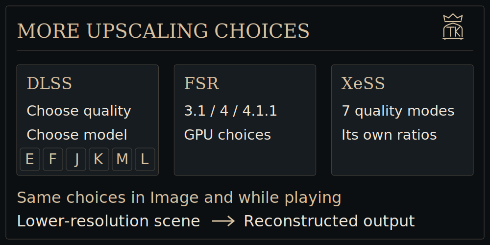

I wanted more control over image quality and more choices for people playing on different GPUs. The original port already had DLSS, FSR and TAA; I added **XeSS Super Resolution** and a separate **DLSS model-preset selector**, with the same settings available in the launcher and while playing. The following shows all the upscaling options provided:

| Upscaler | Available option |
|---|---|
| DLSS 3.7, 4 & 4.5 | Quality/render scale plus a separate model preset; requires a RTX GPU. |
| FSR 3.1 | The existing reconstruction path, also used as a fallback if another provider fails. |
| FSR 4 | Available with its shader assets and the required device features. |
| XeSS Super Resolution 3.0.2 | The added Intel Vulkan integration, with seven dedicated quality modes for supported Intel and other GPUs. |
| TAA / native AA | Temporal AA at the scene's native resolution. |

For DLSS, I exposed the following presets exactly as separate choices:

| Preset | Dropdown label |
|---|---|
| Default | Driver default |
| E | E (CNN / legacy) |
| F | F (CNN / legacy) |
| J | J (Transformer 1st gen) |
| K | K (Transformer 1st gen) |
| M | M (Transformer 2nd gen) |
| L | L (Transformer 2nd gen) |

Be warned that XeSS uses different upscaling ratios when compared to DLSS and FSR — you can read more at  [Upscalers, presets and XeSS resolution examples](docs/upscaling.md)

### Frame Generation and Multi Frame Generation

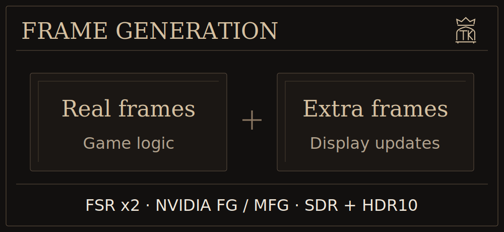

Support was added for **FSR Frame Generation (x2)** and **NVIDIA DLSS FG / MFG (x2–x6 modes for supported GPUs)** to improve display smoothness while keeping the game's real-frame limit separate. FG can work with a different upscaler and both paths support **SDR and HDR10**, which many current integrations in other forks lack. You can activate FG both from the launcher and the in-game menu. I made sure that you can have different FPS limiting options so that one is used when you are not using FG while the other applies only when FG is activated. I go more in-depth with the technicalities of the implementation in the following page: [FG setup, hardware requirements and how the integration works](docs/frame-generation.md)

### NVIDIA Reflex and AMD Anti-Lag 2

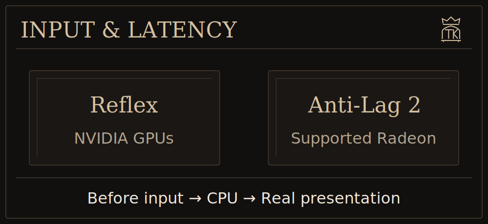

I added independent latency controls because choosing an upscaler or turning Frame Generation off should not remove the option to reduce the render queue. The launcher exposes them in Graphics; the in-game menu has them under Frames. I made **Reflex** a separate Off / On / On + Boost choice, so you can use it without FG. Be warned that NVIDIA FG enables Reflex automatically. I also integrated **AMD Anti-Lag 2** through the supported Radeon Vulkan driver interface.

| Control | Choices | Requirements |
|---|---|---|
| NVIDIA Reflex | Off, On, On + Boost | A supported NVIDIA GPU and driver reporting Reflex availability. |
| AMD Anti-Lag 2 | Off, On | A supported Radeon GPU and driver exposing `VK_AMD_anti_lag`. |

Intel XeSS Low Latency (XeLL) was/is planned but XeLL currently does not support Vulkan. You can read more here: [Latency controls, supported hardware and measurements](docs/latency.md)

### Exact FPS limits

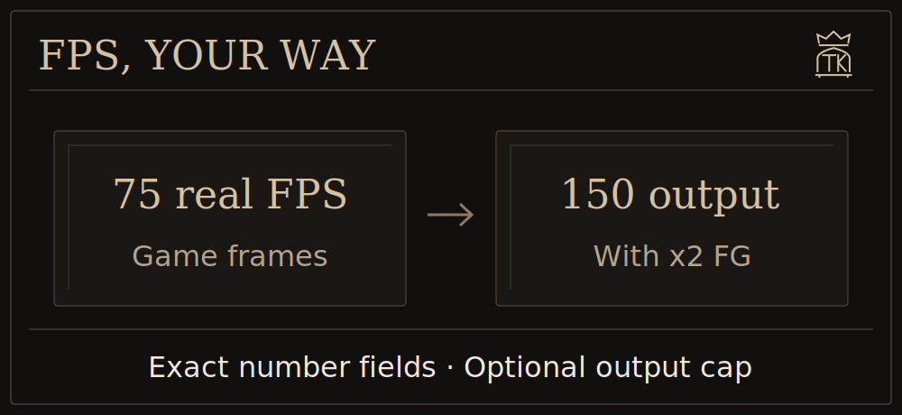

I added **75 FPS**, live real-frame limits and exact number fields alongside the sliders. You can also enable a separate FG output cap: 75 real FPS with x2 can produce up to 150 output FPS; an output cap of 120 lowers the real ceiling to 60.

[Real versus output FPS, live changes and safe timing](docs/display-and-overlay.md#fps-limits)

### A compact overlay you can customize

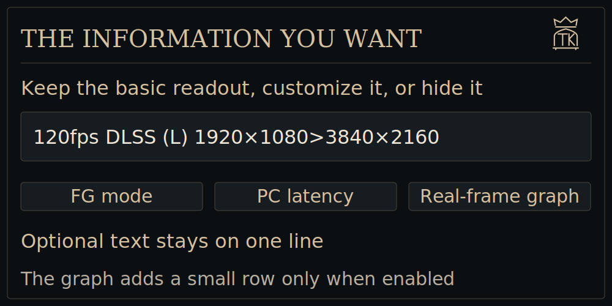

Keep the basic readout, hide it, or add the **DLSS preset letter, input/output resolution, active FG mode and Reflex PC latency**. I also added an optional small **frametime graph** so uneven real-frame delivery is visible. The extra text stays on one line; the graph adds one shallow row when enabled.

[Overlay options and what the frametime graph measures](docs/display-and-overlay.md#performance-overlay)

### Borderless fullscreen and background behavior

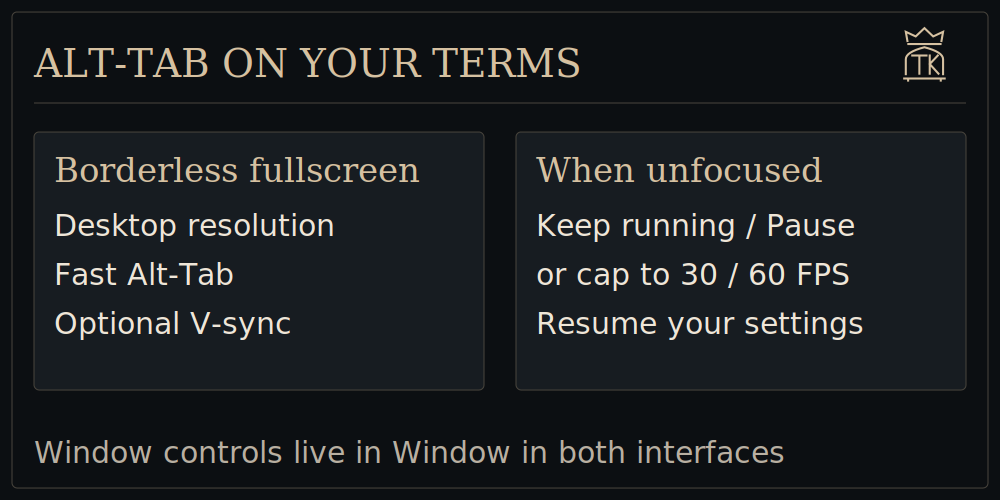

I added **Borderless fullscreen** for easier Alt-Tab and a choice of what happens in the background: keep running, pause the game and rendering, or limit it to 30 / 60 FPS. These options are available in the launcher and in-game.

[Window modes, V-sync and background settings](docs/display-and-overlay.md#window-and-background)

### Temporal stability and renderer optimizations

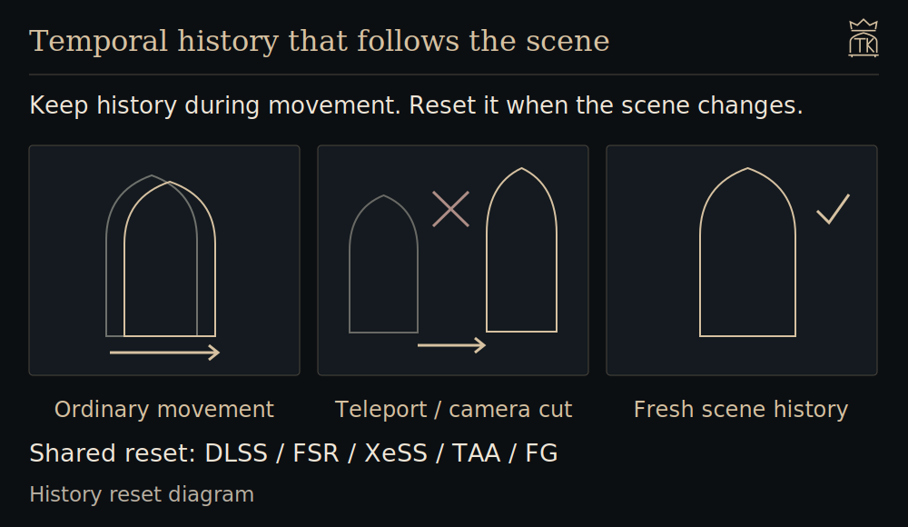

I've worked on motion history, camera resets and unnecessary renderer overhead to improve image stability and frame delivery. I can't guarantee an FPS increase on different configurations yet. Testing from other users is very welcome.

[Quality and renderer work](docs/quality-and-performance.md) · [Performance comparisons](docs/performance.md)

### Optional cheats

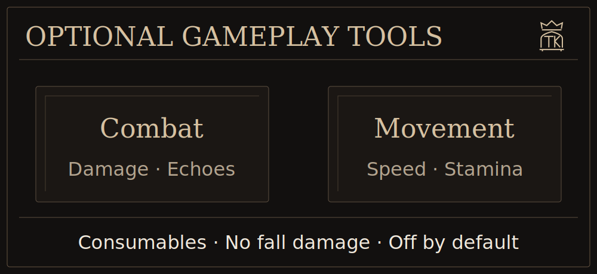

I added **damage, incoming-damage reduction, Blood Echoes and movement multipliers**, plus **Infinite Stamina, consumables/ammunition kept on use and No Fall Damage** alongside the original patches. The runtime choices are shared between the launcher and in-game menu. They start off; the guide tracks the reports that still need work.

[Cheat choices, behavior and current limitations](docs/cheats.md)

### A compact English in-game menu

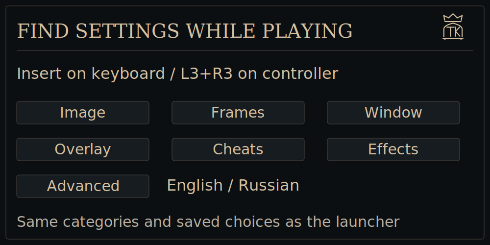

I translated the menu into **English**, retained Russian, and arranged it into **seven tabs** so you can reach a setting without searching through one long page. The menu and launcher share your saved preferences.

[Menu tabs, live settings and restart requirements](docs/launcher-and-menu.md#in-game-settings)

### The Crowned Workshop launcher

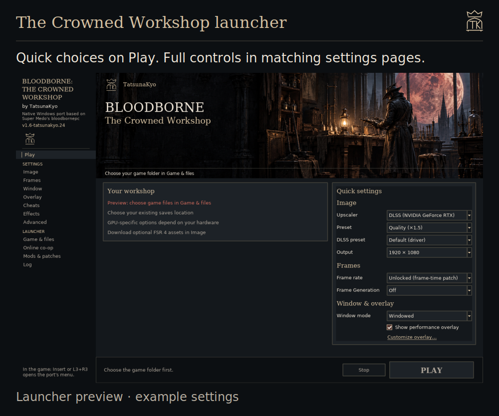

I redesigned the launcher around my workshop, lantern and crowned TK emblem. Play keeps the quick choices together, with conditional DLSS/XeSS controls and a separate NVIDIA multiplier. Detailed settings live on their own pages.

[Launcher tour and screenshots](docs/launcher-and-menu.md#the-launcher)

### Optional developer diagnostics

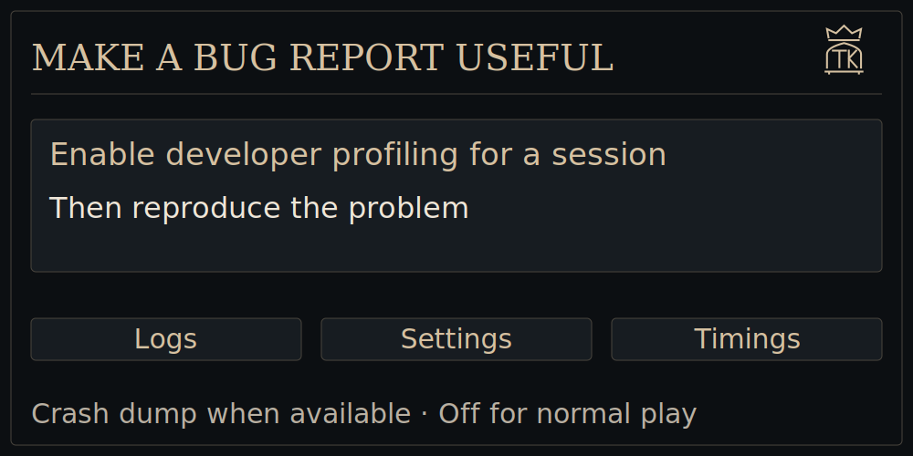

I added an opt-in profiler that keeps session logs, settings, timings and Windows crash details when available. It starts off and can be enabled from **Advanced → Diagnostics** when investigating a problem.

[Diagnostics and useful bug reports](docs/performance.md#comparing-a-change-during-play)

The original mod/patch loading, keyboard/controller support, shortcuts, shader-cache tools, game effects and beta online co-op remain available, with their original credits.

## Requirements and test setup

- **Windows 10 1903 or later / Windows 11**, 64-bit, with a current graphics driver.
- **Vulkan 1.3** support. Specific DLSS/FSR 4/XeSS/FG features have additional GPU and driver requirements.
- Around **6 GB of free memory commit** (RAM plus page file), or **10 GB for 1440p/4K** output.
- Your own decrypted **CUSA03173 1.09** game files.

I test the revisions on my **Windows 11 PC with a GeForce RTX 5070 Ti**. This is the main gameplay test configuration for the fork. Automated tests also cover settings, controls, hook behavior, renderer contracts and package contents. Coverage and open problems are collected in [Testing and known issues](docs/testing.md), rather than repeated throughout the documentation. AMD/Intel hardware and other Windows configurations depend on community feedback.

## Help and development

For a bug report, include your GPU, driver, settings, reproduction steps and `user/last_run.log`. For crashes or performance issues, enable the optional diagnostics before reproducing the problem. [Testing and known issues](docs/testing.md) collects the open reports; [the roadmap](docs/tatsunakyo-next.md) covers planned features and priorities.

For black screens, try **Advanced → Clear shader cache**. Rebuilding it can cause initial stutter. Report fork-specific issues here; the [upstream Discord](https://discord.gg/yTMG8c4Bqm) belongs to the original project.

[Windows build instructions](packaging/windows/README.md) · [Publishing a release](docs/releasing.md)

## Credits

This revision is maintained by [TatsunaKyo](https://github.com/TatsunaKyo). The Windows port and original launcher are by [Supermedo](https://github.com/Supermedo). The upstream history, copyright notices and licenses are retained.

Built on [bbport](https://github.com/deadinside28/bloodborne_pc), the native Linux port of Bloodborne by deadinside28, and on the [shadPS4](https://github.com/shadps4-emu/shadPS4) renderer. The original README is in [docs/original-readme](docs/original-readme/README.md).

Online play uses the network and PSN code of [shadp2p](https://github.com/Wozzardman/shadp2p) by Wozzardman (the shadPS4 Bloodborne co-op project), the shadNet server of the [shadPS4](https://shadps4.net) team, and [The Hunter's Dream](https://thehuntersdream.com) server by droogie and its team.

Also used: [NVIDIA Streamline](https://github.com/NVIDIA-RTX/Streamline) (DLSS Frame Generation and Reflex), [Intel XeSS](https://github.com/intel/xess) (Super Resolution), [FSR-Vulkan](https://github.com/FireBurn/FSR-Vulkan) and the AMD FidelityFX SDK (FSR), FSR 4 assets from [FireBurn/Q2RTX](https://github.com/FireBurn/Q2RTX), the DLSS bridge adapted from [IFreemz/shadPS4-Bloodborne-DLSS-FSR](https://github.com/IFreemz/shadPS4-Bloodborne-DLSS-FSR), the [NVIDIA DLSS SDK](https://github.com/NVIDIA/DLSS) (`nvngx_dlss.dll` under NVIDIA's license), [LibAtrac9](https://github.com/Thealexbarney/LibAtrac9), [SDL3](https://github.com/libsdl-org/SDL), [FFmpeg](https://ffmpeg.org), [Dear ImGui](https://github.com/ocornut/imgui), [sirit](https://github.com/shadps4-emu/sirit), [magic_enum](https://github.com/Neargye/magic_enum), [miniz](https://github.com/richgel999/miniz), [xbyak](https://github.com/herumi/xbyak), [wepoll](https://github.com/piscisaureus/wepoll), [cpp-httplib](https://github.com/yhirose/cpp-httplib), [Protocol Buffers](https://protobuf.dev), [OpenSSL](https://www.openssl.org), [miniupnpc](https://miniupnp.tuxfamily.org), [JSON for Modern C++](https://github.com/nlohmann/json), [Vulkan Memory Allocator](https://github.com/GPUOpen-LibrariesAndSDKs/VulkanMemoryAllocator), [MSYS2](https://www.msys2.org) / [LLVM](https://llvm.org), [PyInstaller](https://pyinstaller.org) and [Pillow](https://python-pillow.org). Game patches by Kyo, Lance McDonald, auser1337, illusion, emoose and the Bloodborne community.

NVIDIA, GeForce RTX and DLSS are trademarks of NVIDIA Corporation.

## License

GNU GPL v2 or later ([LICENSE](LICENSE)). Third-party components keep their own licenses (see `licenses\` in the download).
