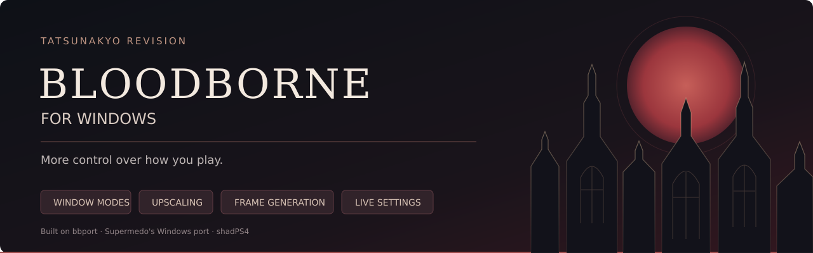

# Bloodborne for Windows — TatsunaKyo revision

My revision of [Supermedo's Windows port](https://github.com/Supermedo/bloodborne_pc), built on bbport and the shadPS4 renderer. The goal is to make the game more comfortable to play on a modern Windows PC: better window controls, more graphics choices, a configurable overlay and settings you can change during play. This project would NOT be possible without the aforementioned work and people.

**Current build: v1.6, revision 10.** [Download Windows builds](https://github.com/TatsunaKyo/bloodborne_pc/releases) · [Revision 10 notes](docs/releases/windows-v1.6-tatsunakyo.10.md)

Always remember that NO game files are included — you NEED your own decrypted **Bloodborne CUSA03173, version 1.09** dump. The game folder must contain `eboot.bin` and its original data. Most game patches and the added cheats depend on 1.09 and will NOT work on any other version of the game.

## How to use it

1. Download the full Windows ZIP from Releases and extract it into a new folder.
2. Open **Bloodborne.exe** and choose your game folder under **Game & effects**.
3. Set your output resolution and graphics options, then press **PLAY**.
4. Press **Insert** or **L3+R3** in-game to change the port's settings.

After setting things up once, **Play Bloodborne.exe** starts the game with the saved options. Saves and shader caches normally live in `user/` beside the launcher; you can choose another saves folder. Keep your existing saves, mods and preferences when updating. Each package includes a SHA-256 checksum and `Start-Verified-Launcher.cmd`, which verifies the included launcher before starting it.

## What this fork adds

### English in-game menu

The menu opened with **L3+R3 / Insert** defaults to English. You can switch between **English and Russian** immediately, independently of the launcher language and the language of the game. The existing launcher still offers its 13 languages.

The in-game checkbox handling also supports repeated mouse clicks, keyboard activation and controller input. Settings are shared with the launcher through `bbport.menu.ini`, so saving launcher preferences preserves changes made during play.

### Borderless fullscreen and background behavior

I added several, different options for window management when compared to the (already great, original work). You can choose **Windowed**, **Borderless fullscreen** or **Fullscreen (driver default)** from the Play, Display & FPS tabs or the in-game menu. Borderless uses the current monitor's desktop resolution and refresh rate, without a display mode switch when you Alt-Tab, which was my main complaint from the original branch.

With **V-sync in borderless** off, the renderer requests Vulkan Immediate presentation and retains the default one-frame GPU queue. This avoids a V-sync wait but can tear. Turning it on requests Mailbox, with FIFO as the compatibility fallback. Windows and the driver determine whether independent flip is available; borderless by itself cannot guarantee a particular measured latency.

**When in background** gives you four choices:

| Setting | Behavior while the window is unfocused |
|---|---|
| Keep running | Keeps the foreground settings. |
| Pause game and rendering | Cooperatively stops game work and rendering, while window events remain responsive. Game clocks exclude the paused time. |
| Limit to 30 FPS | Runs at up to 30 real FPS and restores the foreground cap on return. |
| Limit to 60 FPS | Runs at up to 60 real FPS and restores the foreground cap on return. |

Frame Generation is disabled during background pause or a background FPS limit. Keep running preserves it. These choices are available in the launcher and in-game alike.

### DLSS model presets

DLSS render presets are separate from **Quality / Balanced / Performance / Ultra Performance**: the quality setting changes input resolution, while the letter requests a reconstruction model.

| Preset | Dropdown label |
|---|---|
| Default | Driver default |
| E | E (CNN / legacy) |
| F | F (CNN / legacy) |
| J | J (Transformer 1st gen) |
| K | K (Transformer 1st gen) |
| M | M (Transformer 2nd gen) |
| L | L (Transformer 2nd gen) |

You can select a preset in **Play**, **Graphics** and the in-game menu. Changing it during play recreates the DLSS feature without restarting the game. The Play row appears only when DLSS is selected; Graphics keeps the choice visible but disabled with another upscaler. Saved selections are retained when switching providers.

### Upscaling choices, including DLSS, FSR and XeSS

The graphics selector includes **DLSS**, **FSR 3.1**, **FSR 4**, **XeSS Super Resolution 3.0.2** and **TAA / native AA**. XeSS uses Intel's Vulkan API with scene depth, motion vectors and linear color conversion. If a provider fails or the required hardware features are missing, the renderer reports the problem and falls back to FSR 3.1. I do not currently own an Intel GPU, thus the burden of testing lies on eventual users.

DLSS needs a supported GeForce RTX GPU. FSR 4 also needs its included shader assets and the required device features. XeSS availability depends on the GPU and driver. The full Windows package includes the necessary runtime files and their licenses.

### Upscaler-independent FSR and DLSS Frame Generation, DLSS Multi Frame Generation and NVIDIA Reflex

**Frame Generation** is available directly on **Play** and Graphics tab, and in-game. A temporal upscaler must be active; FSR FG can also be combined with DLSS or XeSS.

| Choice | Included integration |
|---|---|
| FSR Frame Generation | Analytical **FSR 3.1.6**, generating one intermediate frame for 2x output. |
| NVIDIA DLSS Frame Generation / MFG | **Streamline 2.14.1** with the production **DLSS-G 310.9.1** runtime; fixed 2x–6x choices, clamped to what the GPU and driver support. |
| NVIDIA Reflex | **Off**, **On** or **On + Boost**, independently of FG and the upscaler. NVIDIA FG enables Reflex automatically; Boost remains optional. |

Both FG backends accept **SDR and HDR10**. FSR converts PQ color to linear half-float for interpolation and back to HDR10 afterward. NVIDIA uses the actual SDR/HDR10 backbuffer and stable depth/motion inputs. Input lifetime is tied to completion fences before buffers can be reused.

The overlay distinguishes real game FPS from generated output. NVIDIA output uses the SDK's actual presentation counter, rather than multiplying the real FPS by the requested mode. See [the FG guide](docs/frame-generation.md) for hardware requirements, latency readouts and current limitations.

### Arbitrary FPS caps and separate toggles for Frame Generation caps

The normal **FPS cap** limits real game frames. **75 FPS** is included between 60 and 90. FG can add output frames above that limit: 75 real FPS with 2x FG can produce up to 150 output FPS.

An optional **Limit total FPS with Frame Generation** has a separate **30–1000** setting. It accounts for the active multiplier without raising the real-frame cap or advancing physics for generated frames. For example, 75 real FPS with a 120 total cap at 2x lowers the real-frame ceiling to 60. A value that does not divide evenly may produce a slightly lower total.

Both caps have an editable number box as well as more precise drag controls, so that the user can arbitrarily cap FPS. **BE WARNED** total-cap range is a configuration range, not a claim that the game can sustain 1000 FPS. I recommend to keep real-frame limits at 120 or below: the original game logic can misbehave at extreme real FPS. Of course, testing and reporting is encouraged in order to improve the project.

### A compact, configurable overlay

**Show performance overlay** switches the OSD on or off in the launcher and in-game. The original basic overlay is still available for minimalistic users. You can independently add:

| Optional field | What it shows |
|---|---|
| DLSS preset | The accepted preset hint as a letter, such as `DLSS (M)`. `K>M` means a change is pending. Driver overrides may still choose another internal model. |
| Input/output resolution | The current scene and display dimensions, such as `1280x720>3840x2160`. |
| Frame Generation | Whether generation is confirmed active, its provider and the negotiated multiplier. |
| PC latency | A completed NVIDIA Reflex report, or `N/A` when unavailable. It excludes the display and input device. |

The extra fields stay on the same compact line; the full CNN/Transformer descriptions remain in the preset dropdowns. On Play, **Customize overlay…** opens Display & FPS, while the main overlay checkbox stays on the page. Each extra field starts off, keeping the original layout unless you choose otherwise.

### Cheats you can change during play

The added options live in the same **Cheats** section as the original patches. They start off and can be changed from the launcher or the in-game menu. Those are completely optional and any uninterested user can ignore this section entirely.

| Cheat | Available choices / effect |
|---|---|
| Player damage | x2, x4, x8, x16 outgoing damage. |
| Reduce enemy damage | Divides incoming enemy damage by x2, x4, x8 or x16. Defense stats do not change. |
| Blood Echoes gained | x2, x4, x8, x16 positive rewards; spending and the game's balance ceiling stay intact. |
| Movement speed | x1.5, x2, x4, x8, x16 for the player. |
| Infinite stamina | Covers action, continuous movement and direct stamina consumption paths. |
| Consumables are not reduced on use | Keeps owned items and ammunition after use. |
| No fall damage | Skips ordinary player fall damage; death volumes and scripted deaths still apply. |

The loader verifies the 1.09 instruction signatures and player binding before installing each feature. A conflicting or mismatched patch disables that feature and logs the reason. NPCs and ordinary inventory transfers retain their normal behavior. The original startup patches are marked as requiring a restart. Details and regression coverage are in [the cheat guide](docs/cheats.md).

### Temporal stability and renderer work

Revision 10 adds a shared camera-history reset for teleports, abrupt camera/FOV changes, resolution changes and returning from frames without a camera. The same reset reaches **DLSS, FSR, XeSS, TAA and Frame Generation**. On the transition frame, motion uses the current camera and discards stale object history; smooth movement and gradual zoom keep temporal accumulation.

The renderer also avoids repeated camera memory checks after capture, caches the unchanged scene mip bias, reuses Vulkan image views and skips repeated read-to-read transitions for the object-motion image. Index-buffer revalidation is spread across 32 frames instead of returning as a scene-wide periodic burst. The production cache test with 4,096 meshes reduces the periodic peak from **4,096 to 149 scans per frame**, with the same maximum revalidation interval. This is a workload result; actual FPS depends on the scene and hardware.

These changes target stale history and avoidable renderer work. [Quality and performance notes](docs/quality-and-performance.md) explain the remaining work on motion coverage and HUD separation.

### Optional developer diagnostics

**General → Diagnostics → Developer profiling and crash diagnostics** enables per-session logs, active settings, timings, exit codes and Windows crash dumps when available. It is off by default. This helps investigate crashes without requiring everyone to run the profiler during ordinary play. [Performance notes](docs/performance.md) describe optional comparisons.

### Launcher and update integration

The launcher identifies this build as **TatsunaKyo revision** and checks releases from this fork. It accepts matching Windows revision packages, preserving saves, mods and settings during updates. The Play grid reserves positions for conditional DLSS/FG controls so they stay aligned and the NVIDIA multiplier does not overlap Output. Small windows and higher DPI reduce the banner to leave space for the controls.

The upstream features remain available: keyboard/controller support, mod and community-patch loading, desktop/Steam shortcuts, shader-cache tools, game effects and beta online co-op through shadNet and The Hunter's Dream. These keep their original project credits.

## Requirements and test setup

- **Windows 10 1903 or later / Windows 11**, 64-bit, with a current graphics driver.
- **Vulkan 1.3** support. Specific DLSS/FSR 4/XeSS/FG features have additional GPU and driver requirements.
- Around **6 GB of free memory commit** (RAM plus page file), or **10 GB for 1440p/4K** output.
- Your own decrypted **CUSA03173 1.09** game files.

I test the revisions on my **Windows 11 PC with a GeForce RTX 5070 Ti**. This is the main gameplay test configuration for the fork. Automated tests also cover settings, controls, hook behavior, renderer contracts and package contents. Coverage and open problems are collected in [Testing and known issues](docs/testing.md), rather than repeated throughout the documentation. AMD/Intel hardware and other Windows configurations depend on community feedback.

## Problems and feedback

Include your GPU, driver version, settings, reproduction steps and `user/last_run.log` when sending a bug report. For a crash, enable the optional diagnostics before reproducing it and attach that session's output. The reported crash while firing with several cheats enabled is still under investigation. The game HUD can also show FG interpolation artifacts; separating it is follow-up work.

For black screens, try **Advanced → Clear shader cache**. Rebuilding the cache can cause initial stutter. Dynamic NVIDIA MFG, Intel XeSS FG, AMD ML FG and FG model presets A/B are not included; their status is listed in [the roadmap](docs/tatsunakyo-next.md).

Report fork-specific issues here. The [upstream community Discord](https://discord.gg/yTMG8c4Bqm) is maintained by the original project; check the original Windows build before sending a fork regression upstream.

## Building and publishing

[Windows build instructions](packaging/windows/README.md) cover MSYS2 CLANG64, the renderer, launcher and runtime packaging. [Release instructions](docs/releasing.md) cover the tag, source commit and ZIP checksum. Both the launcher and native components are rebuilt for each revision package.

## Credits

This revision is maintained by [TatsunaKyo](https://github.com/TatsunaKyo). The Windows port and original launcher are by [Supermedo](https://github.com/Supermedo). The upstream history, copyright notices and licenses are retained.

Built on [bbport](https://github.com/deadinside28/bloodborne_pc), the native Linux port of Bloodborne by deadinside28, and on the [shadPS4](https://github.com/shadps4-emu/shadPS4) renderer. The original README is in [docs/original-readme](docs/original-readme/README.md).

Online play uses the network and PSN code of [shadp2p](https://github.com/Wozzardman/shadp2p) by Wozzardman (the shadPS4 Bloodborne co-op project), the shadNet server of the [shadPS4](https://shadps4.net) team, and [The Hunter's Dream](https://thehuntersdream.com) server by droogie and its team.

Also used: [NVIDIA Streamline](https://github.com/NVIDIA-RTX/Streamline) (DLSS Frame Generation and Reflex), [Intel XeSS](https://github.com/intel/xess) (Super Resolution), [FSR-Vulkan](https://github.com/FireBurn/FSR-Vulkan) and the AMD FidelityFX SDK (FSR), FSR 4 assets from [FireBurn/Q2RTX](https://github.com/FireBurn/Q2RTX), the DLSS bridge adapted from [IFreemz/shadPS4-Bloodborne-DLSS-FSR](https://github.com/IFreemz/shadPS4-Bloodborne-DLSS-FSR), the [NVIDIA DLSS SDK](https://github.com/NVIDIA/DLSS) (`nvngx_dlss.dll` under NVIDIA's license), [LibAtrac9](https://github.com/Thealexbarney/LibAtrac9), [SDL3](https://github.com/libsdl-org/SDL), [FFmpeg](https://ffmpeg.org), [Dear ImGui](https://github.com/ocornut/imgui), [sirit](https://github.com/shadps4-emu/sirit), [magic_enum](https://github.com/Neargye/magic_enum), [miniz](https://github.com/richgel999/miniz), [xbyak](https://github.com/herumi/xbyak), [wepoll](https://github.com/piscisaureus/wepoll), [cpp-httplib](https://github.com/yhirose/cpp-httplib), [Protocol Buffers](https://protobuf.dev), [OpenSSL](https://www.openssl.org), [miniupnpc](https://miniupnp.tuxfamily.org), [JSON for Modern C++](https://github.com/nlohmann/json), [Vulkan Memory Allocator](https://github.com/GPUOpen-LibrariesAndSDKs/VulkanMemoryAllocator), [MSYS2](https://www.msys2.org) / [LLVM](https://llvm.org), [PyInstaller](https://pyinstaller.org) and [Pillow](https://python-pillow.org). Game patches by Kyo, Lance McDonald, auser1337, illusion, emoose and the Bloodborne community.

NVIDIA, GeForce RTX and DLSS are trademarks of NVIDIA Corporation. The icon is original artwork.

## License

GNU GPL v2 or later ([LICENSE](LICENSE)). Third-party components keep their own licenses (see `licenses\` in the download).
