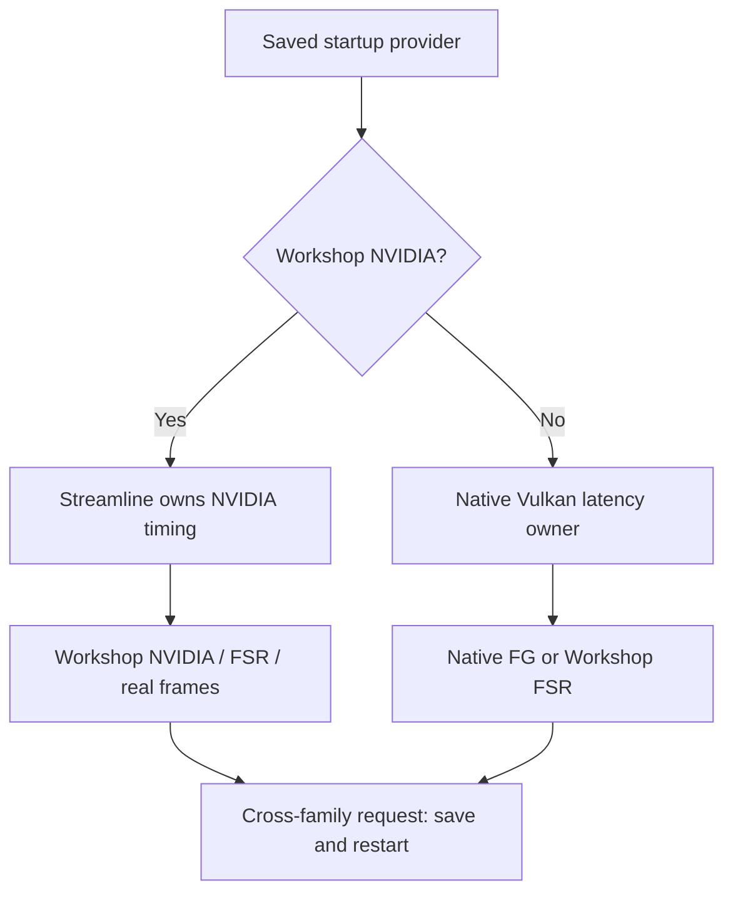

# Current integration map

**Source R56 is unreleased. Published R55 is unchanged.** Supermedo Windows is integrated through `b48052617a919fc4d6b10ae3395e209c9e94e17a` (1.9.7). The previous common upstream baseline was `de2e38af055f09f819946951075c6bb119e62ae6`.

| Area | Current owner and contract | Compatibility decision |
|---|---|---|
| Guest patches and startup | `run.py`, `scripts/patches.py`, `patches/` | Current scripts and patch data travel together. Executable fingerprints still gate game modifications. |
| Memory tracking | Upstream `page_manager`, `buffer_cache`, `texture_cache`, rasterizer | Adopt one complete tracker generation. The previous multi-level tracker/sparse backing experiments are superseded. |
| Shader and pipeline persistence | `cache_storage`, `vk_shader_util`, `vk_pipeline_serialization` | Keep Workshop bounds/CRC checks, draining accepted writes and per-session motion-address relocation; add upstream build fingerprint, parallel preload and separate driver cache. |
| Speculative preparation | `vk_pipeline_cache` | Immutable templates are copied and guest tables read outside the publication lock; busy speculative work yields to the GPU thread. |
| Draw and copy completion | `vk_draw_pipe`, `vk_bind_helper`, scheduler | Keep sleeping long drains, wake ordering and copy-batch publication before guest data can be reused. |
| Native FG | `Vulkan::FrameGenerator`, `vk_frame_generation` | Upstream analytical FSR, native DLSS and experimental AMD ML-FG; detached completion and input retirement remain owned here. |
| Workshop FG | `Vulkan::FrameGeneration`, `vk_workshop_frame_generation` | Retain HDR-capable FSR and Streamline, immutable scene inputs and diagnostic capture. No duplicate native adapter class. |
| NVIDIA timing | Streamline **or** native Vulkan low latency | Startup selects one owner. Cross-family changes require restart and preserve the saved request. |
| Caps | `BbSettings::EffectiveFrameLimit`, absolute flip deadlines | Real cap is canonical; output cap uses the active multiplier. Fixed guest timing cannot be overridden by a live cap. |
| Shared controls | `bbport_settings`, `bbport_workshop`, native PC menu | One provider mapping and real cap across all three interfaces; XeSS quality stays independent. |
| Overlay | Workshop compact readout plus upstream system metrics | Real intervals, app-present graph, render latency and Reflex report have separate labels and validity. |
| Launcher | Upstream 1.9.7 foundation plus `bbport_workshop.py` | Preserve Save Manager, Support Report, cheats, model controls and gated Encore. Actual page construction is tested. |
| Distribution | `tools/assemble_windows.py` | One verified ZIP and checksum. Fresh executables/assets/current startup sources, pinned NVIDIA/AMD dependencies and required licenses/source. |

## Provider and latency boundary

Stock RTX 40/50 files remain the default. RTX 20/30 Encore is opt-in, requires the user's compatible external library and does not bundle NR. An initialized mod FG provider does not prove that its NR path works.

## Accepted, superseded and pending

| State | Work |
|---|---|
| Integrated in source | Upstream 1.9.7 renderer/launcher/input/save/online changes; FSR 4.1.1/4.1.2; experimental ML-FG; PC Settings and memory/latency readouts. |
| Preserved and reconciled | Workshop HDR, Streamline x2–x6, DLSS model requests/evidence, XeSS modes, independent caps, cheats, save/support tools and gated Encore. |
| Superseded | Duplicate native FG adapter; old tracker/sparse arena generation; split-package writer for new releases; parallel independent cap/provider selections. |
| Hardware acceptance open | Cemetery traversal hitch, physical 120-Hz cadence, stair halos and transient foreground assets; AMD/RTX 20/30/provider/HDR matrix. |
| Future work | HUDless colour/UI recomposition; Dynamic MFG on a supported Vulkan API; XeSS FG/XeLL; named save profiles. |

[Verification record](investigations/2026-11-02-supermedo-197.md) · [Roadmap](tatsunakyo-next.md) · [Current reports](known-issues.md) · [Guides](index.md)
