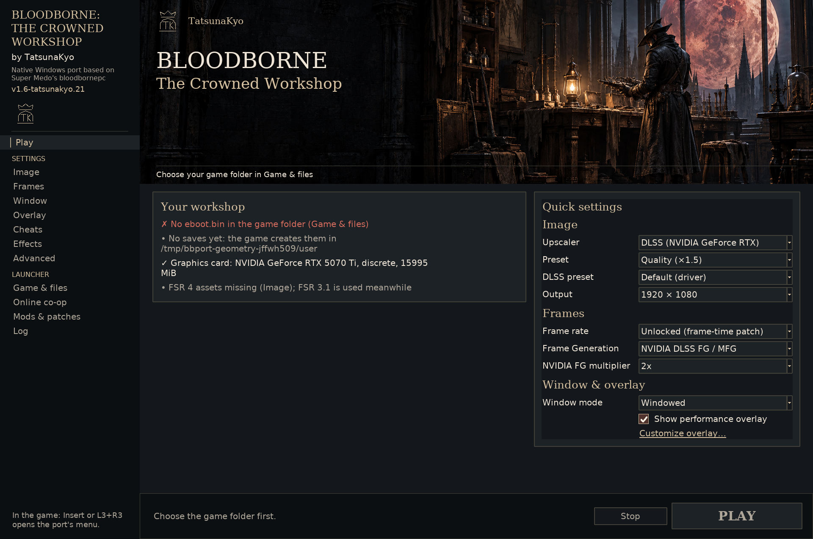
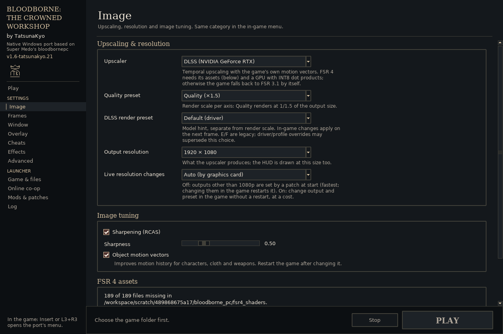
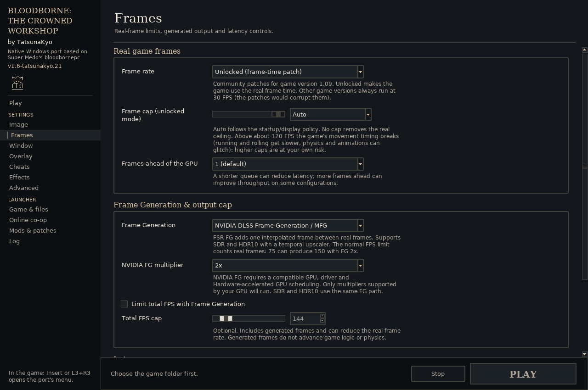
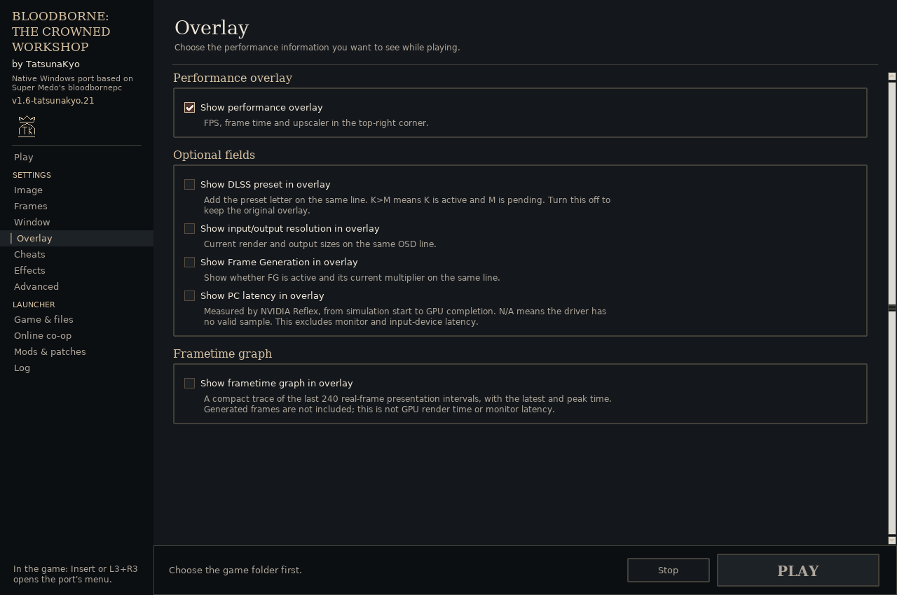
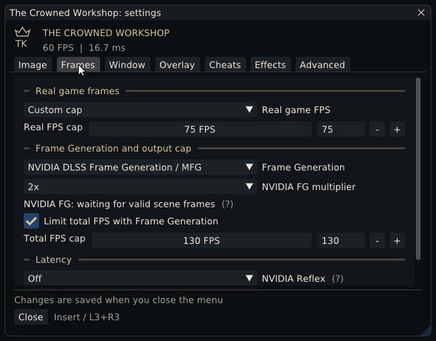

# Launcher and in-game settings

**Current source: R56 / Supermedo 1.9.7, unreleased.** The published Windows download remains R55. [Integration and verification](investigations/2026-11-02-supermedo-197.md) · [Published releases](releases/index.md)

R55 includes Supermedo 1.9.2 input/camera changes. **Controls** supports three binding slots, combinations and direct mouse look; prompts can follow the device or stay on a selected layout. **Effects → Field of view** defaults to 43° and needs restart. **Window → Mute in background** is separate from Pause. **Image → HUD position** adjusts ultrawide placement. **Other versions** remains available in the launcher.

## Installation

Extract the full Windows package into a new folder and open **Bloodborne.exe**. Select your decrypted Bloodborne CUSA03173 1.09 folder under Game & files, then choose resolution and graphics settings. For R55, those controls start on Play; for R56, use Graphics. No game files are included.

Saves and shader caches normally live in `user/` beside the launcher. You can select an existing saves folder; keep it and your mods/preferences when updating. **Play Bloodborne.exe** launches with saved settings. The single ZIP includes **Start-Verified-Launcher.cmd**, **Capture-Traversal.cmd** and **Capture-NVIDIA-FG.cmd** beside the launcher. No Developer companion is required.

## The launcher

I redesigned it around my workshop, lantern and crowned TK emblem, with slate panels and warm brass accents. The sidebar includes my name, the current version and Super Medo's original port credit.

In the published R55 launcher, Play keeps the quick controls together. DLSS's model selector appears when DLSS is selected; XeSS has its own quality selector, and NVIDIA FG has a separate multiplier row. The sidebar separates Settings from launcher-only tools. Each complete control has one settings page, with bordered sections separating related choices. Play uses the same preferences as shortcuts. **Customize overlay…** opens **Overlay** at its controls.

R55 appearance reference (the R56 launcher adopts the newer upstream layout):

Historical R55 setup screenshot:

The in-game Workshop menu retains seven tabs. R56’s launcher adopts the upstream simple/expert navigation; the Graphics page includes the shared Workshop provider/model, XeSS quality, cap and overlay controls. Use Graphics for display, reconstruction, FG and readouts; Cheats for runtime and startup cheats; Saves for imports and the Workshop Save Manager; and Advanced for diagnostics. The table below lists the corresponding game menu tabs.

### Image, Frames and Overlay

These R55 screenshots show the published launcher’s separate categories. Image groups reconstruction, resolution and image tuning; Frames separates real game frames, generated output and latency; Overlay groups the master switch, optional fields and graph.

## Native PC Settings

R56 also integrates Supermedo’s controller-driven System → PC Settings page. Upscaler values include XeSS and FSR 4.1.2; XeSS keeps its seven independent quality modes. Its FG values map to the same Workshop/native routes rather than creating a second selection. The ImGui menu remains available.

## In-game settings

Press **Insert** or **L3+R3** to open the menu. I added English and retained Russian; switching the menu language is immediate and independent of the launcher/game language. The launcher retains its original 13 languages.

| Tab | Settings |
|---|---|
| Image | Upscaling, quality, DLSS model presets, ten output resolutions, ultrawide HUD position, sharpening and object motion. |
| Frames | Real-frame cap, FG and latency controls. |
| Window | Window mode and background behavior. |
| Overlay | Overlay visibility, optional fields and the frametime graph. |
| Cheats | Runtime cheat choices and original startup cheats. |
| Effects | Model detail, game effects, camera and gameplay patches. |
| Advanced | Menu language, renderer switches and diagnostics; launcher-only management also lives here. |

The current launcher groups these controls in its upstream navigation. Some startup/management controls are launcher-only, and some live reconstruction diagnostics are menu-only; shared options keep their saved values across the interfaces. The seven tabs keep the close/restart controls in place. Wide windows use two columns for effects, and the workshop palette carries into the game.

### LIVE editing and saved preferences

I made the added runtime controls useful **LIVE, without closing and restarting the game**. DLSS model presets, supported FG/latency modes, unlocked frame caps, window/background behavior, runtime cheats and overlay choices can be adjusted here while playing. Enable **Image → Live resolution changes** before launching if you also want to compare upscalers, quality modes and output resolutions during the session. [The live-settings table](live-settings.md) lists the startup exceptions.

The launcher and menu share `bbport.menu.ini`. Saving from the launcher preserves choices changed during play. The in-game menu saves when closed; settings that need a restart show that explicitly. DLSS presets, overlay choices and unlocked real-frame limits can change during the session. Startup patches retain their restart requirement.

I corrected the ignored-checkbox handling and check real clicks, keyboard/controller navigation and both menu languages. The launcher layout is checked at 100–200% scaling. [Testing](testing.md) records the current checks.

More detail: [Upscaling](upscaling.md) · [Frame Generation](frame-generation.md) · [Display and overlay](display-and-overlay.md) · [Cheats](cheats.md) · [Diagnostics](performance.md)

## Support and save tools

**Generate Support Report** is in **Advanced → Workshop diagnostics** and **Log** in R56. It reuses existing diagnostics, shows a sanitized file preview and exports a verified ZIP for manual sharing. [Contents and privacy](support-reports.md)

**Open Save Manager** is in **Saves → Workshop snapshots** in R56 (**Game & files** in R55). It provides pre-launch backups, named snapshots, verified restore/rollback and retention for that selected location. Save operations require a closed game. [Backups and recovery](save-manager.md)

<!-- workshop-current-navigation -->
[All current guides](index.md) · [Published releases](releases/index.md) · [Source maintenance](maintenance.md)
