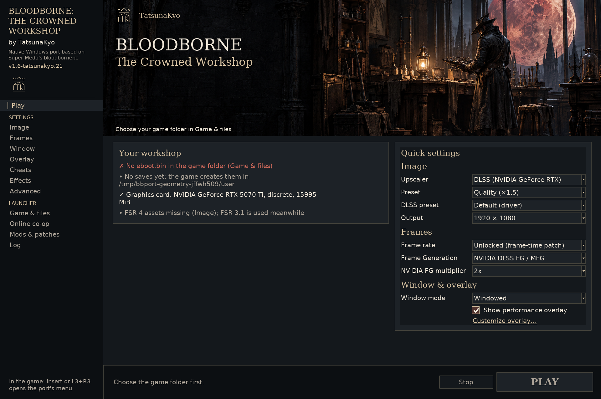
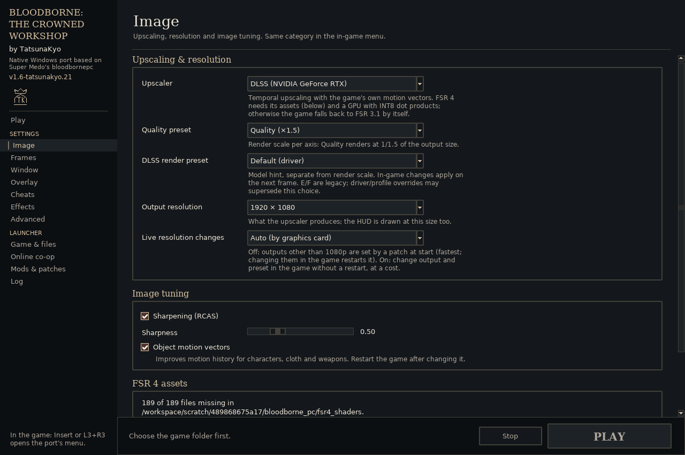
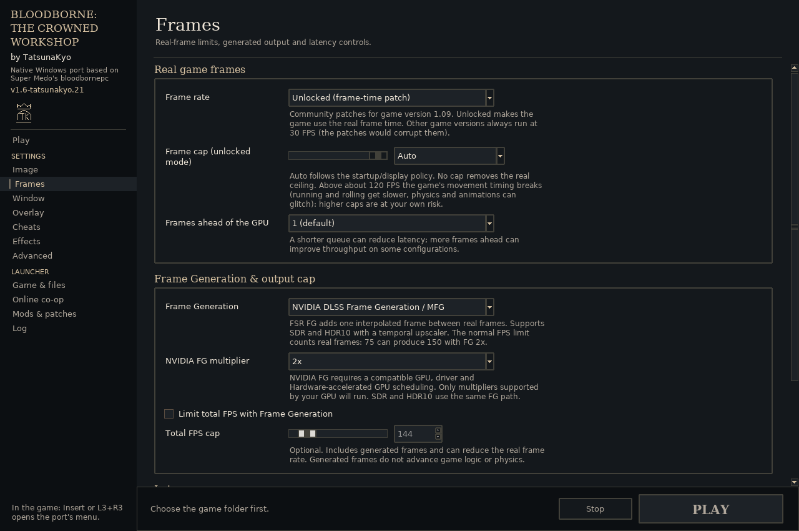
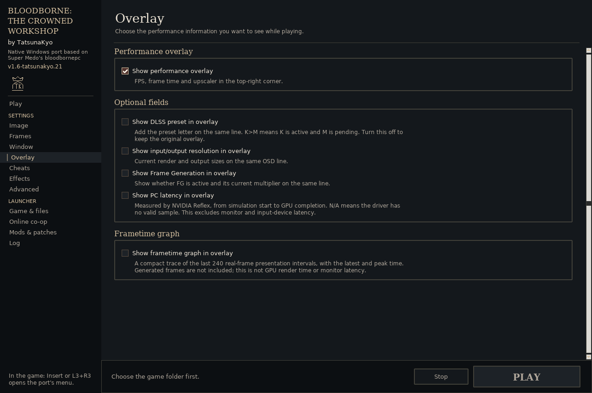
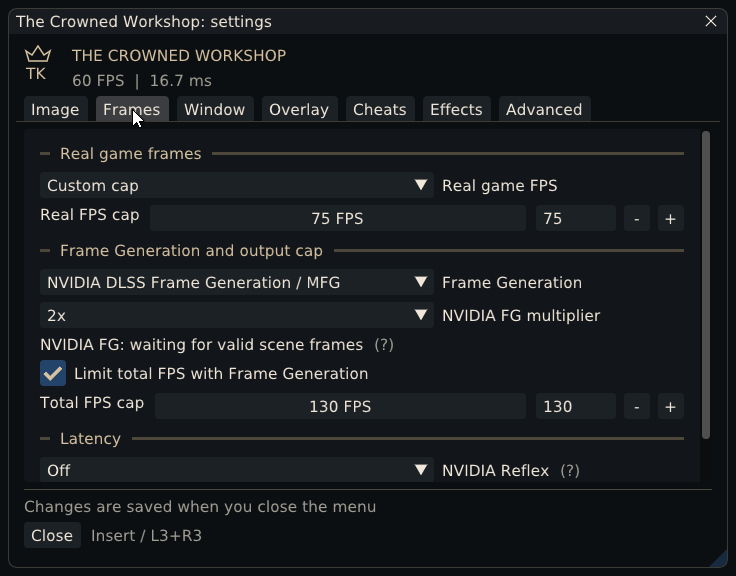

# Launcher and in-game settings

## Installation

Extract the full Windows package into a new folder and open **Bloodborne.exe**. Select your decrypted Bloodborne CUSA03173 1.09 folder under Game & files, then choose the resolution and graphics settings on Play. No game files are included.

Saves and shader caches normally live in `user/` beside the launcher. You can select an existing saves folder; keep it and your mods/preferences when updating. **Play Bloodborne.exe** launches with saved settings. The optional Developer archive keeps **Start-Verified-Launcher.cmd** and the specialist capture scripts under `diagnostics/`; extract it beside the game folder or pass your installation folder as a script's first argument.

## The launcher

I redesigned it around my workshop, lantern and crowned TK emblem, with slate panels and warm brass accents. The sidebar includes my name, the current version and Super Medo's original port credit.

Play keeps the quick controls together. DLSS's model selector appears when DLSS is selected; XeSS has its own quality selector, and NVIDIA FG has a separate multiplier row. The sidebar separates Settings from launcher-only tools. Each complete control has one settings page, with bordered sections separating related choices. Play uses the same preferences as shortcuts. **Customize overlay…** opens **Overlay** at its controls.

My earlier setup screenshot:

Both interfaces use the same seven categories. Full launcher controls have one home each; Play retains quick access to their shared values. Game & files, Online co-op, Mods & patches and Log handle launcher tasks.

### Image, Frames and Overlay

The full settings use separate bordered sections. Image groups reconstruction, resolution and image tuning; Frames separates real game frames, generated output and latency; Overlay groups the master switch, optional fields and graph.

## In-game settings

Press **Insert** or **L3+R3** to open the menu. I added English and retained Russian; switching the menu language is immediate and independent of the launcher/game language. The launcher retains its original 13 languages.

| Tab | Settings |
|---|---|
| Image | Upscaling, quality, DLSS model presets, output resolution, sharpening and object motion. |
| Frames | Real-frame cap, FG and latency controls. |
| Window | Window mode and background behavior. |
| Overlay | Overlay visibility, optional fields and the frametime graph. |
| Cheats | Runtime cheat choices and original startup cheats. |
| Effects | Model detail, game effects, camera and gameplay patches. |
| Advanced | Menu language, renderer switches and diagnostics; launcher-only management also lives here. |

The same category names apply to the launcher. Some startup/management controls are launcher-only, and some live reconstruction diagnostics are menu-only; shared options keep their category in both. The seven tabs keep the close/restart controls in place. Wide windows use two columns for effects, and the workshop palette carries into the game.

### LIVE editing and saved preferences

I made the added runtime controls useful **LIVE, without closing and restarting the game**. DLSS model presets, supported FG/latency modes, unlocked frame caps, window/background behavior, runtime cheats and overlay choices can be adjusted here while playing. Enable **Image → Live resolution changes** before launching if you also want to compare upscalers, quality modes and output resolutions during the session. [The live-settings table](live-settings.md) lists the startup exceptions.

The launcher and menu share `bbport.menu.ini`. Saving from the launcher preserves choices changed during play. The in-game menu saves when closed; settings that need a restart show that explicitly. DLSS presets, overlay choices and unlocked real-frame limits can change during the session. Startup patches retain their restart requirement.

I corrected the ignored-checkbox handling and check real clicks, keyboard/controller navigation and both menu languages. The launcher layout is checked at 100–200% scaling. [Testing](testing.md) records the current checks.

More detail: [Upscaling](upscaling.md) · [Frame Generation](frame-generation.md) · [Display and overlay](display-and-overlay.md) · [Cheats](cheats.md) · [Diagnostics](performance.md)

## Support and save tools

**Generate Support Report** is in Advanced → Diagnostics and Log. It reuses existing diagnostics, shows a sanitized file preview and exports a verified ZIP for manual sharing. [Contents and privacy](support-reports.md)

**Open Save Manager** is in Game & files beside the saves-folder selection. It provides pre-launch backups, named snapshots, verified restore/rollback and retention for that selected location. Save operations require a closed game. [Backups and recovery](save-manager.md)
